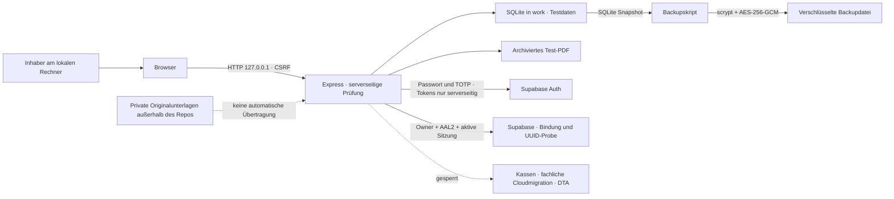

# Bedrohungsmodell · lokale Testversion 0.1

Stand 22.10.2026. Schutzobjekte: Rechnungsoriginale, korrekte Beträge, Fahrtenzuordnung, Rechnungsnummern, Ereignisjournal, Backups und Anmeldesitzungen. Aktuell sind ausschließlich erfundene Daten erlaubt. Die lokale App unterstützt den festgelegten Inhaber mit Passwort/TOTP; bei `TAXIDTA_AUTH_REQUIRED=true` schützt derselbe Backend-Prüfpfad alle fachlichen APIs. Persönlicher Live-Login und Gesundheitsdatenfreigabe stehen noch aus. Der unkonfigurierte synthetische Demo-Modus bleibt ausdrücklich ohne Konto erreichbar.

## Datenfluss und Vertrauensgrenzen

Browser, lokaler Server, Datenbank/Dateisystem, Backupablage, Supabase Auth und externe Empfänger sind getrennte Grenzen. Loopback schützt nicht vor anderer Schadsoftware, anderen lokalen Nutzern oder einem kompromittierten Browser. HTTP auf Loopback ist nur für Testdaten vertretbar. Öffentlicher Betrieb erfordert HTTPS, geprüfte Authentisierung und Wiederherstellung, Geräte-/Sitzungsschutz und neue Freigabe. Die derzeit blockierte SDK-Netzverbindung darf keinen anonymen Ersatzpfad öffnen.

## STRIDE und Missbrauchsfälle

| Gefahr | Beispiel | Kontrolle/Prüfung | Verbleibend |
|---|---|---|---|
| Identitätsvortäuschung | Fremde Webseite spricht localhost an | Host-/Origin-Prüfung, CSRF, keine öffentliche Bindung; bei Anmeldepflicht zusätzlich fester Owner/AAL2/aktive Sitzung | Persönlicher Cloudlogin noch ungetestet; kompromittierter Rechner bleibt privilegiert |
| Manipulation | Preis, Steuer, Fahrt oder Empfänger wird geändert | Server berechnet Positionen, Beträge und Rechnung neu; Schemas; unbekannte DTA-Routen sperren | SQLite-Datei kann durch Besitzer geändert werden |
| Abstreitbarkeit | Zahlung/Rechnung nachträglich überschrieben | Ereignisjournal mit Hashverkettung, Original-PDF, Stornobezug | Ohne externen Anker ist die Kette nicht manipulationssicher |
| Informationsabfluss | Testdaten oder Anmeldetokens gelangen in Git/Backup | Private Konfiguration ausgeschlossen; keine fachliche Cloudübertragung; Backupverschlüsselung; no-store; Tokens nur im Serverprozess | Aktive lokale DB ist nicht zusätzlich verschlüsselt; Supabase erhält Anmeldung und begrenzte UUID-Prüfdaten |
| Verfügbarkeit | Große Eingaben, beschädigte DB, Verlust des Macs | Eingabelimits; konsistente Backups; Restore-Test | Kein Hochverfügbarkeitsbetrieb, kein automatischer Zeitplan |
| Rechteausweitung | Fremder Projektbenutzer oder behauptetes AAL2 | Angewendete RLS-/RPC-Sperren, fester Owner, bestätigter aktiver Benutzer und passende auth.sessions-Zeile; keine Client-Tabellenrechte | Echte negative SQL-Fälle bestanden; persönlicher positiver Ablauf und spätere Finanz-/Dateiisolation offen; DB-Administrator bleibt privilegiert |
| Doppelabrechnung | Zwei gleichzeitige Rechnungsbefehle für eine Fahrt | Datenbanktransaktion, eindeutige Zuordnung, Nummernvergabe | Empfänger-/Bankabgleich fehlt |
| Falsche Annahme | Bereitschaftsprüfung wird als Kassenannahme gezeigt | Nur blockierter Bereitschaftsbericht; kein Transportadapter | Offizielle DTA-Konformität fehlt |
| Schädliches PDF/Upload | Parser wird durch Datei angegriffen | Kein allgemeiner Upload in der Version | Später Quarantäne, Scan, isolierter Parser, MIME/Größenprüfung nötig |
| Schlüsselverlust | Backup ohne Passphrase | Passphrase nicht im Backup; falsches Passwort scheitert | Verlust ohne sichere Hinterlegung ist nicht behebbar |

## Freigabebedingungen für spätere Produktion

1. Datenschutzprüfung einschließlich Art. 6/9 DSGVO, Verantwortlichkeit, AVV/DPA, Drittlandverarbeitung, Lösch-/Aufbewahrungsplan und DSFA-Erforderlichkeit.
2. Projektweite Registrierung kontrollieren, persönlichen Passwort-/TOTP-Ablauf am bereits gebundenen Inhaberkonto prüfen und sicheren Wiederherstellungsprozess ergänzen. Passkeys und Recovery sind noch nicht implementiert. Bank-/IK-Änderungen und Versand benötigen später gesonderte sichere Abläufe.
3. Supabase `eu-central-1` ist bestätigt; tatsächliche Regionen und Unterauftragsverarbeiter von App, Jobs, Storage, Logs und Backups gesondert prüfen.
4. Nachgewiesene §302-Spezifikation, zulässiger Transport, eigene Teilnahme, Zertifikate, aktuelle IK-Rollen und echte Testquittung.
5. Unabhängiger Sicherheitsreview, produktnahe Negativtests und dokumentierter Restore. Gezielte Anwendbarkeit von §393 SGB V fachkundig prüfen.
